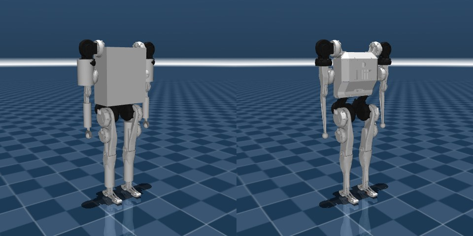

# 2026-09-25 (금)

## Q1. 참조 성형 (`--refshape`) 을 하면 외란에 취약해지지 않나?

> 참조 성형 = 전신 정의 축의 ω 참조를 "골반이 멈춰 있는 값" `Î⁻¹ L_다리` 로 (9/24 Q30). 목표가 `τ = L̇_다리`,
> 즉 다리 반작용을 골반 대신 **땅 (발 모멘트)** 이 받아내라는 것 — 그러면 밀렸을 때 버틸 여유가 줄지 않나?

### 1. 이론 — 밀렸을 때의 반응 자체는 같다

QP 는 `½UᵀHU + gᵀU`, `g = 2BᵀQ(A x₀ + d − X_ref) − …`. 참조 성형은 `X_ref` 만 바꾸고 `H · A · B · 제약` 은 그대로다.
밀려서 상태가 `Δx₀` 바뀌면 (제약에 안 걸리는 한) `ΔU = −H⁻¹ · 2BᵀQA · Δx₀` — **X_ref 가 없다.** 되먹임 이득은 같고, 평소 걸음의 기준점만 옮긴다.
걷기의 주 복구 수단인 착지점 (Raibert · capture point) 과 CoM 제어도 건드리지 않는다.

차이가 날 수 있는 곳은 **제약** — 발 모멘트 (CoP 가 발 안, 비틀림 마찰) 예산을 평소에 `L̇_다리` 받아내느라 일부 쓰면, 밀렸을 때 여유가 적다.

### 2. 측정 — 걷는 중 밀기 ([affine/26_push_walk.py](../MPC/src/affine/26_push_walk.py), 새로 만듦)

0.5 m/s 로 걷다가 골반에 F [N] 을 0.1 s (충격 F × 0.1 N·s, 33 kg 이면 Δv = F / 333 m/s). 걸음 위상 두 곳 (20.0 · 20.4 s, 지지 발 반대).
민 뒤 8 s 를 버티면 통과. 50 N 간격, 처음 넘어진 힘 바로 아래를 "버틴 최대".

| 구성 | 앞 +x | 뒤 −x | 옆 +y |
|---|---|---|---|
| H (참조 성형) | 100 / 100 N | ≥ 300 / ≥ 300 N | 100 / 100 N |
| H (성형 없음) | 100 / 100 N | ≥ 300 / ≥ 300 N | 100 / 100 N |
| R (섞기) | 100 / 100 N | ≥ 300 / ≥ 300 N | 100 / 100 N |

넘어진 시각도 거의 같다 — 앞 150 N @ 20.0 s: 세 구성 모두 21.1 ~ 21.2 s, 옆 150 N @ 20.0 s: 23.8 / 24.3 / 24.6 s.

### 3. 읽기

- **참조 성형은 외란 내성을 떨어뜨리지 않았다** (50 N 해상도에서 세 구성 동일). 이론대로 — 되먹임 이득이 같고, 이 정도 밀기에선 발 모멘트 예산이 먼저 바닥나지 않는다.
- 대신 **구성과 무관한 약점이 드러났다**: 앞으로 150 N (Δv ≈ 0.45 m/s) 이면 약 1.2 s 만에, 옆으로 150 N 이면 4 ~ 8 s 에 걸쳐 넘어진다.
  뒤로는 300 N (Δv ≈ 0.9 m/s) 도 버틴다. 앞으로 밀리면 걸음이 빨라져야 하는데, 0.7 m/s 추종이 87 % 인 **속도 벽**과 같은 뿌리로 보인다 (추정).
- 결과가 단조롭지 않은 곳이 있다 — 앞 250 · 300 N 은 일부 버텼다 (H 참조 성형 @ 20.0 s, H 성형 없음 250 N 두 시점). 큰 힘이 다른 착지 패턴을 만드는 것으로 보인다.
  그래서 "버틴 최대" 는 거친 지표다 (시점 2 개, 50 N 간격, 0.5 m/s 하나).

---

## Q2. MIT 휴머노이드 — 받은 MJCF 검증 + reference 컨트롤러 Python 이식, reference 수치 재현

> 클로드 챗에서 받은 MIT 휴머노이드 URDF→MJCF (`mit_humanoid_mjcf/`) 를 검증하고, reference 를 참고해 MPC 폴더 안에
> MIT 휴머노이드용 파이썬 컨트롤러를 만들어 reference 데모 수치 (전진 0.6 m/s · 횡 0.3 m/s · 제자리 회전 1.3 rad/s) 를 재현.
> 코드 [MPC/src/mit/](../MPC/src/mit/) (README 에 실행법·결과), 모델 [MPC/models/mit_humanoid/](../MPC/models/mit_humanoid/).

### 1. MJCF 검증 — 변환은 정확하다

원본 URDF (hojae-io `humanoid_full_sf.urdf`) ↔ MJCF ↔ MuJoCo URDF importer 를 21 바디·18 관절·32 geom 전부 수치 대조:
질량·CoM·관절 축/범위 차이 **0**, 관성·자세 최대 4e-7 (쿼터니언 소수 6 자리). 총 24.89 kg, 다리 42.8 %.
빠진 것만 채웠다: 발 접촉 site (발바닥 선 중앙 (0.03, 0, −0.04)), timestep 0.002 (reference 값), 모터 반사 관성 (URDF `rotor_inertia` → armature).

**서기 자세가 맞지 않았다**: reference yaml 관절값 `[0,0,−0.735,1.2,−0.70]` 을 이 모델에 넣으면 발가락이 13.5° 들리고 CoM 이 뒤꿈치 끝 →
관절 PD 만으로 1 s 안에 넘어진다. "발 평평 + 발이 CoM 바로 아래" 로 역산하면 무릎 0.997 rad 에서 골반 높이가 **0.6791 m** —
yaml `base_position_W` 0.679472 와 0.4 mm 차이. reference 의 (비공개) 모델은 이 자세였고 관절 0 점만 다르다고 본다. 키프레임 `stand` 로 넣었다.
이 자세도 관절 PD 만으론 1.5 s 에 넘어져서 (게인이 이 무게에 약함) reference 의 "2 s PD 초기화" 는 건너뛰고 바로 서기 MPC 로 시작 (편차 D2).

### 2. 이식 과정 (에이전트 워크플로)

1. reference C++ 를 영역별로 명세화 (MPC · 계획 · 저수준 · 오케스트레이션) → 명세마다 적대적 검증자가 원본과 대조 (61 건 수정, 치명 0).
   명세에서 새로 드러난 reference 특이점: MPC 접촉 예정표가 **걸음 주기 원점 기준** (O1), 걷기 중 **방향 되먹임 없음** (O4),
   MPC 질량은 몸통+팔 14.23 kg (다리 제외), 명령 필터가 걷기 시작 틱에 스냅, 몸통 속도는 몸통 링크 CoM 의 속도.
2. 모듈 3 갈래 병렬 구현 + 단위 검사 148 개 통과, 서기 스모크 테스트 통과.
3. 컨트롤러 통합 (`runController` 17 단계 순서 그대로) → 검토자 2 명이 C++ 과 줄 단위 대조, 한 틱 손계산 — **불일치 0** (코드 읽기 기준. 실행 대조는 안 함 — Q4).

### 3. 결과 (120 s)

| 구성 | 전진 0.6 | 횡 0.3 | 회전 1.3 |
|---|---|---|---|
| 충실한 이식 (명령 처음부터 = reference 헤드리스 기본) | ✗ 0.2 s | ✗ 0.2 s | ✗ 2.5 s |
| 충실한 이식 + 명령 2 s 램프 | ✗ 22 s | ✗ 13 s | ✗ 5 s |
| 변형들 (armature 끔 · quadprog · 마찰 여유 · OSQP 설정 · 마커 질량) | ✗ 1 ~ 25 s | | |
| **램프 + `yawref` (방향 유지 한 줄)** | **✓ 88 %** | **✓ 70 %** | **✓ 100 %** |
| 램프 + `slide + yawref` + OSQP 4000 회 | ✓ 92 % | ✓ 79 % | ✓ 100 % |

⚠ 정정 (Q11): 이 표의 이식은 OSQP 설정 두 개 (`adaptive_rho_interval` 100, `check_dualgap` 0) 가 reference 실효값 (50, 1) 과 달랐다. reference 실효 설정으로는 램프 + yawref 84 / 70 / 100 %. reference 자신도 이 모델에서 세 목표 모두 넘어진다 (Q11).

서기 10 s · 제자리 걸음 120 s 는 충실한 이식 그대로 통과. (% = 명령 대비 실제 속도, 마지막 100 s)

### 4. 읽기

- **충실한 이식은 헤드리스로는 reference 수치를 못 낸다.** 코드 대조 (두 검토자 + 손계산) 로는 불일치 0 — ⚠ 정정 (Q4): **reference 를 실제로 돌려 출력을 비교하지는 않았다.** '이식 오류가 아니다' 는 코드를 읽은 기준에서만 맞다.
- **원인은 방향 되먹임 (O4)** — reference 는 걷기 중 MPC yaw 참조를 매번 측정 yaw 로 다시 잡는다 (서기 모드는 목표 yaw 를 쓴다).
  명령 0 인데도 yaw 가 0.015 rad/s 씩 흘러가고, 착지점 계획 (명령 적분 yaw) 과 몸 방향이 갈라져 넘어진다.
  MPC yaw 참조를 목표 yaw 로 바꾸는 한 줄 (`yawref`) 로 세 목표가 모두 120 s 를 넘는다 (측정).
  ⚠ 정정 (Q3): 처음에 "데모는 사람이 키보드로 몰며 방향을 바로잡았다" 고 썼는데, **키보드는 코드·GIF 근거가 있는 추론, 방향 보정은 근거 없는 추측**이다.
- **주기 원점 기준 접촉 예정표 (O1)** 는 이상하지만 (오른발 스윙 중에 MPC 가 곧 왼발이 뜬다고 예정), "지금부터" 로 고치면 (`slide`)
  접촉 패턴이 매 풀이 바뀌어 cold start 비율 0.11 → 0.87 ~ 0.99, 반복 상한 200 에선 오히려 나빠진다 (측정). 정확한 풀이와 같이 써야
  조금 낫다 (횡 70 → 79 %). ⚠ 정정 (Q3): "그래서 reference 가 일부러 원점에 고정했다" 는 **근거 없는 추측** — 문서는 이유를 적지 않았다.
- 남은 것: 횡 속도 추종 70 % (선 모양 발이라 옆 방향 CoP 여유가 ±1 cm — 옆 균형이 착지점만으로 된다), 회전에서 스윙 다리
  hip abad (34 N·m) 포화 34 ~ 62 % (reference 와 같은 한계에서 clamp), armature 에 매우 민감 (끄면 제자리 걸음도 1.6 s 에 넘어짐 —
  reference 모델의 armature 는 모름). **걸음 모양은 렌더로 확인 필요.**

```bash
.venv/Scripts/python.exe MPC/src/mit/10_walk.py --view --vx 0.6 --profile ramp --fix yawref
.venv/Scripts/python.exe MPC/src/mit/10_walk.py --view --wz 1.3 --profile ramp --fix yawref
```

---

## Q3. "데모는 키보드로 몰았다", "OSQP 해 재사용 때문에 원점 고정" — 각각 어디서 나온 말인가

**둘 다 사실과 추론이 섞여 있었다. 구분하면:**

### 1. 키보드

| 근거 | 종류 |
|---|---|
| reference 헤드리스 명령 주입은 전진 속도만 된다 — 환경변수 `CONVEXMPC_HEADLESS_X_DOT_{START_TIME, FINAL, RATE, PROFILE}` 뿐, y·yaw 용은 없다 ([SimulationRunner.cpp:459-532](../reference/sim/src/SimulationRunner.cpp#L459)) | 코드 사실 |
| 그 밖의 입력 경로는 키보드 (w/s/a/d/q/e, README) 뿐. 웹 대시보드 나침반은 필터된 명령을 **보여 주기만** 한다 ([web_dashboard.md:14, 195](../reference/docs/web_dashboard.md)) | 코드·문서 사실 |
| 데모 GIF 프레임에 MuJoCo **GUI 뷰어** 정보창 (`Time 78.720 …`) 이 찍혀 있다 — 헤드리스가 아니다. 클립은 긴 세션의 중간: 전진 sim 78.7 → 89.7 s (GIF 14.0 s), 회전 77.4 → 103.4 s (33.5 s), 횡 GIF 14.9 s, 전체 데모 98.3 s | 측정 (GIF 프레임) |
| ⇒ 횡·회전 데모는 (공개 코드 기준) 키보드로만 낼 수 있다 | **추론** (저자가 적은 곳은 없음, 수정된 로컬 빌드일 가능성 배제 못 함) |
| "사람이 방향을 계속 바로잡아서 버텼다" | **근거 없는 추측** — 프레임·문서 어디에도 없다 |

대안 설명도 남아 있다: reference 의 비공개 MIT 모델 (armature · damping · 디버그 마커 질량) 이 더 튼튼할 수 있다 (U1·U2).
참고로 그 GUI 세션은 sim 100 s 넘게 서 있었는데 (회전 클립이 103 s), 우리 충실한 이식은 램프 명령으로도 전진 22 · 횡 13 · 회전 5 s 에 넘어진다 —
차이가 "사람의 방향 보정" 하나로 설명되는지는 모른다.

### 2. OSQP 해 재사용 (warm start)

| 근거 | 종류 |
|---|---|
| reference 는 직전 해를 한 칸 밀어 OSQP 초기값으로 쓰고 (`use_shifted_warm_start`, ConvexMPC.cpp:1094-1108), 접촉 패턴 (signature) 이 바뀌면 재설정 + cold start 한다 (ConvexMPC.cpp:880-906; 문서 [gait_scheduler_and_contact_management.md:180-182](../reference/docs/gait_scheduler_and_contact_management.md)) | 코드·문서 사실 |
| 우리 이식: 원점 고정이면 cold 비율 0.11 (한 주기 4 번 step 0 이 바뀜 ≈ 8 회/s), `slide` 면 0.87 ~ 0.99. `slide` + reference 설정 (반복 200) 은 6.3 s 에 넘어짐, fallback 34 회 | 측정 |
| ⇒ 원점 고정은 결과적으로 warm start 를 살린다 | 측정에서 나온 **해석** |
| "그래서 reference 가 일부러 원점에 고정했다" | **근거 없는 추측** — 문서가 적은 목적은 "시간이 가도 위상을 일관되게 계산하려고 cycle 원점 t0 를 둔다" ([gait_scheduler_and_contact_management.md:26](../reference/docs/gait_scheduler_and_contact_management.md)) 뿐, warm start 이야기는 없다. 그냥 버그일 수도 있다 |

---

## Q4. reference 를 실제로 돌려 보지 않았으니, 이식이 맞는지 검증이 안 된 것 아닌가

**맞다.** 한 검증은 **코드 읽기 대조 (정적)** 이고, **실행 결과 대조 (동적)** 는 하지 않았다.

| 한 것 | 한계 |
|---|---|
| 검토자 2 명이 C++ 과 줄 단위 대조 | 명세 작성자·검토자가 같은 방식으로 잘못 읽으면 못 잡는다 |
| 한 틱을 C++ 식을 따로 옮겨 적어 재계산 (차이 0) | 역시 '읽은 식' 끼리의 비교 |
| 단위 검사 148 개 (명세 수치 기준) | 명세 자체가 C++ 을 읽어 만든 것 |
| 다리 동역학 D4 = MjSpec 고정 기반 모델 (4e-15) | 이건 수치 검증이지만 우리 편차 하나만 |

못 한 것: 같은 모델·같은 상태에서 reference 실행 파일과 출력 비교. 이유 — reference 는 Linux/macOS 전용 (termios, POSIX 공유 메모리),
이 PC 엔 빌드 도구·WSL 이 없고, MIT 모델은 비공개. 남는 위험: 공통 오독, OSQP 0.6.x vs 1.1.3, Eigen vs numpy 반올림, 안 거친 코드 경로.
⚠ 정정 (Q6): reference 를 vcpkg baseline 대로 실제 빌드하면 osqp 는 **1.0.0** 이다 (0.6.x 는 명세 02 §10.1 이 `c_float` API 에서 추론한 값). 아래 1 단계는 WSL2 가 아니라 Ubuntu PC 에서 됐다 (Q6).
**그래서 Q2 의 "이식 오류 아님", "원인은 방향 되먹임" 은 우리 이식 안에서만 맞는 말이다** — reference 가 이 모델에서 헤드리스로 똑같이 실패하는지는 모른다.
✅ (Q11) 실행 비교를 했다: reference 도 세 목표에서 넘어진다. 이식은 모든 모듈이 기계 정밀도로 일치하고, 불일치는 OSQP 설정 두 개뿐이었다.

### 제대로 검증하는 법 — reference 의 디버그 로그와 차분 비교

reference 의 `StandingMpcDebugLogger` 가 MPC 풀이 순간을 JSON 으로 남긴다 (yaml `logging.standing_mpc_debug_trigger_times` 또는 Shift+L,
걷기 중이면 `logs/debug/walking_mpc/`): `full_qpos/qvel`, `full_tau_command`, `x0`, 축소 몸체 질량·CoM·관성, 다리별 `Jv/Jw/q/qd`·명령 모드·`p_des/v_des/a_des`,
접촉 관리자 상태, `touchdown_yaw`, 참조 궤적 (`tk, psi, r_left/right, X_ref`), `A_c/B_c/A_qp/B_qp`, wrench 지평·첫 wrench, 예측 상태, wrench→토크.

1. WSL2 (Ubuntu) 에 reference 빌드 (Q&A 9/25 대화의 절차).
2. 우리 MIT 모델을 reference 이름 규칙으로 바꾼 복사본 + yaml (초기 자세 수정) 을 `reference/models/mit_humanoid/` 에.
3. reference 를 헤드리스로 걷게 하며 여러 시각에 스냅샷 JSON.
4. Python 에서 스냅샷을 읽어 같은 입력을 우리 모듈에 넣고 단계별 비교 — x0·질량/관성 (1e-9), X_ref·r, A_qp·B_qp (1e-9), 제약,
   첫 wrench (OSQP 허용오차), 토크 (1e-9). 상태 읽기는 스냅샷의 `full_qpos/qvel` 로 따로 비교 (reference 는 기구학이 1 틱 묵은 값).
5. 같은 초기 상태·같은 명령으로 두 쪽을 돌려 처음 1 ~ 3 s 궤적 비교 (그 뒤는 혼돈으로 갈라진다).

---

## Q5. Windows → Ubuntu 이전 — 환경 구성과 수치 재기준

**결론**: Ubuntu 22.04 에서 Windows 와 같은 패키지 버전으로 환경을 다시 만들었다. 대표 표 두 개를 다시 돌린 결과
**G1 affine 표는 9 개 지표가 전부 같고, MIT 표는 6 칸 중 5 칸이 같다 (1 칸 1 %p 차이)** (측정).
이 두 표 범위에선 Q&A 수치를 그대로 인용해도 된다.

### 1. 환경 — SETUP.md 가정과 다른 점

| 항목 | SETUP.md 가정 | 이 PC | 대응 |
|---|---|---|---|
| OS | Ubuntu 24.04 | **22.04.5** | — |
| Python | 3.12 이상 | 시스템 **3.10** | `numpy==2.5.3`·`scipy==1.18.1` 이 `Python>=3.12` 를 요구 (uv 의존성 해석, 측정) → `uv venv --python 3.13 --seed .venv` (3.13.15. Windows 는 3.13.2) |
| GPU | CUDA 빌드 가능하면 | Intel 내장만 | torch 2.14.0+cpu |
| 경로 | `~/work/residual-RL` | `~/Desktop/residualRL` | 영문 경로라 한글 우회 불필요 |

requirements.txt 고정 버전은 그대로 설치됐다 (mujoco 3.12.0, numpy 2.5.3, scipy 1.18.1, osqp 1.1.3 …). 외부 저장소 3 개는 SETUP 절차대로.
코드에 남은 Windows 흔적은 동작에 영향 없음 (코드 사실): docstring 의 `.venv/Scripts/python.exe`·`PYTHONIOENCODING` (주석),
`viewer_hud.boost_process` (`sys.platform != "win32"` 면 아무것도 안 함), 한글 경로 VFS 로더 (그대로 동작). 줄바꿈은 전부 LF.

### 2. 재기준 ① — G1 affine 걸음 품질 (H 안, 120 s)

```bash
GAIT_ON=1 .venv/bin/python MPC/src/affine/18_gait_quality.py --seconds 120 --vx 0.5 0.7 \
    --var "tds=1.25,copm=0.9,wzp=1,wxp=0,ctl=affine,refshape=1"
```

| vx | 환경 | 추종 | pitch 평균 | pitch σ | roll σ | 디딤 무릎 | 스윙 모음 | 발 yaw 미끄럼 | 골반 yaw |
|---|---|---|---|---|---|---|---|---|---|
| 0.5 | Windows (9/24 Q35) | 104 % | −3.9° | 2.36° | 1.00° | +1.6° | 3.8° | 0.1° | 3.6° |
| | **Ubuntu** | 104 % | −3.9° | 2.36° | 1.00° | +1.6° | 3.8° | 0.1° | 3.6° |
| 0.7 | Windows | 87 % | −3.2° | 2.76° | 1.26° | +2.5° | 4.2° | 3.1° | 5.1° |
| | **Ubuntu** | 87 % | −3.2° | 2.76° | 1.26° | +2.5° | 4.2° | 3.1° | 5.1° |

두 속도 모두 120 s 완주. Ubuntu 쪽 나머지 지표: 스윙오차 1.27 / 1.55 cm, 합력최저 61 / 58 %, 스윙 토크 초과 0 %.

### 3. 재기준 ② — MIT 세 목표 (120 s)

```bash
.venv/bin/python MPC/src/mit/11_gait_quality.py --cmd 0.6,0,0 0,0.3,0 0,0,1.3 \
    --var "profile=ramp,fix=yawref" "profile=ramp,fix=slide+yawref,maxit=4000" --seconds 120
```

| 구성 | 환경 | 전진 0.6 | 횡 0.3 | 회전 1.3 |
|---|---|---|---|---|
| 램프 + `yawref` | Windows (Q2) | ✓ 88 % | ✓ 70 % | ✓ 100 % |
| | **Ubuntu** | ✓ 88 % | ✓ 70 % | ✓ 100 % |
| 램프 + `slide+yawref` + OSQP 4000 회 | Windows | ✓ 92 % | ✓ 79 % | ✓ 100 % |
| | **Ubuntu** | ✓ 92 % | ✓ **80 %** | ✓ 100 % |

횡 79 → 80 % 가 부동소수점 차이인지 반올림 경계인지는 확인하지 않았다.
⚠ (Q11): 이 표는 이식 OSQP 설정 (100 / 0) 기준이다. reference 실효 설정 (50 / 1) 으로 램프 + yawref 는 84 / 70 / 100 %.
그 밖에 `mit/02_unit_checks_A.py` 0 FAIL, `mit/10_walk.py --vx 0.6 --profile ramp --fix yawref --seconds 20` 추종 91.2 % (측정).

### 4. 실행 시간 (참고)

- MIT 20 s 걷기: 다른 작업이 없을 때 실제 22 s (MPC 중앙값 8.3 ms) — 거의 실시간. 18 번 표와 동시에 돌렸을 땐 52 s (21 ms).
- affine 18 번 표 (120 s × 2 병렬): 실제 4 분 14 초, CPU 시간 73 분 (18 코어가 거의 참). affine 폴더는 BLAS 스레드를 1 로 고정하지 않아
  스레드가 과하게 뜨는 것일 수 있다 (근거 없는 추측, 미확인).

---

## Q6. reference (C++) 를 Ubuntu 에서 빌드 — 무엇을 고쳐야 했나

**결론**: 빌드·실행 성공 (G1). SETUP 절차에서 두 군데를 바꿨다 — MuJoCo 빌드에서 Wayland 끄기, reference 한 줄 API 수정.
MIT 는 reference 에 모델이 없어 아직 못 돌린다. 덤으로 Q4 의 "OSQP 0.6.x" 가 틀렸다는 걸 확인했다.

### 1. 설치물 (저장소 밖)

| | 위치 | 비고 |
|---|---|---|
| vcpkg | `~/.local/vcpkg` | `~/.bashrc` 에 `VCPKG_ROOT` |
| MuJoCo **3.12.0** | 소스 `~/.local/src/mujoco`, 설치 `~/.local/mujoco` | 파이썬 `mujoco==3.12.0` 과 같은 태그 — C++·Python 차분 비교 때 엔진 차이를 없애려고 |
| reference 의존성 (vcpkg.json baseline `4bc07e3`) | `reference/build/vcpkg_installed` | eigen3 5.0.1, glfw3 3.4, nlohmann-json 3.12.0, **osqp 1.0.0**, osqp-eigen 0.11.0, yaml-cpp 0.9.0 (빌드 로그, 측정) |

### 2. 고친 것 (SETUP.md 에 반영)

| 단계 | 문제 | 대응 |
|---|---|---|
| MuJoCo cmake | 딸려 오는 GLFW 가 `wayland-scanner` 를 못 찾아 실패 | `-DGLFW_BUILD_WAYLAND=OFF` (X11 만. Wayland 세션에선 XWayland 로 뜬다) |
| reference 컴파일 | `mjData` 에 `qM` 이 없다 — MuJoCo 3.12 에서 `mj_fullM(m, dst, d->qM)` 이 `mj_fullM(m, d, dst)` 로 바뀜 | `reference/sim/src/LegSwingDynamicsProvider.cpp:227` 한 줄 (하는 일 같음: 질량 행렬을 dense 로 펼치기). **reference 로컬 수정**이라 `git pull` 때 충돌할 수 있다 |

### 3. 실행 확인 — G1 헤드리스 15 s (`./build/apps/main g n`)

서기 완료 t = 2.0 s → 걷기 전환 4.5 s → **t = 9.2 s 부터 `OsqpEigen did not converge ... MaxIterReached` 반복** (측정).
명령 없이 제자리 걸음이었다 (키보드 입력은 TTY 가 아니라 꺼짐). 넘어졌는지는 이 로그로는 모른다.
reference 의 G1 설정은 미튜닝 출발값이라 (9/24 Q3) 예상 범위일 수 있으나 확인하지 않았다.

### 4. Q4 정정 — OSQP 버전

Q4 의 남은 위험 "OSQP 0.6.x vs 1.1.3" 에서 0.6.x 는 이식 명세 ([02_reference_mpc_spec.md](../MPC/src/mit/specs/02_reference_mpc_spec.md) §10.1) 가
"코드가 `c_float` API 를 쓰니 0.6.x" 라고 **추론**한 값이었다. reference 의 vcpkg baseline 으로 실제 빌드하면 **osqp 1.0.0** (측정).
→ C++ 1.0.0 vs Python 1.1.3 으로 둘 다 1.x. 다만 이식이 0.6 기본값 (PROFILING 때의 `adaptive_rho_interval` 시간 규칙 등) 을 흉내 내도록
정한 설정은 1.0.0 기준으로 다시 확인해야 한다 (추론 — 1.0.0 기본값은 아직 안 봄). ✅ (Q11) 실제로 두 개가 달랐다. 명세·[mit/README.md](../MPC/src/mit/README.md) 에도 정정 표시.

### 5. 다음 (Q4 계획의 2 단계부터)

`reference/models/mit_humanoid/` 가 비어 있다 (MIT MJCF 비공개). 우리 MIT 모델을 reference 이름 규칙으로 바꾼 복사본 + yaml 을 넣으면
Q4 의 차분 검증 (디버그 JSON 스냅샷 → `A_qp`·`B_qp`·wrench·토크 비교) 을 할 수 있다.

---

## Q7. Ubuntu 뷰어 문제 세 가지 — MIT 모양이 엉성함, 닫을 때 segfault, 화면 1/4 에만 그려짐

**결론**: 셋 다 뷰어(그리기)만의 문제였고 물리·헤드리스 결과는 그대로다 (측정). ① 충돌 도형을 group 3 으로,
② 뷰어 스레드가 끝날 때까지 기다리기 (7 곳), ③ `PYGLFW_LIBRARY_VARIANT=x11`.

### 1. MIT 모양이 엉성하다 → 충돌 도형이 메시 위에 겹쳐 그려졌다

- **더 나은 공개 모델은 없다.** MuJoCo Menagerie 에 MIT 휴머노이드 없음, reference `models/mit_humanoid` 는 빈 폴더.
  공개 URDF 두 곳 ([hojae-io/LearningHumanoidArmMotion-RAL2025-Code](https://github.com/hojae-io/LearningHumanoidArmMotion-RAL2025-Code),
  [se-hwan/pbrs-humanoid](https://github.com/se-hwan/pbrs-humanoid)) 은 같은 `meshes_v3` (STL 11 개, 파일 크기까지 같음) 를 쓰고, 우리 MJCF 도 이 메시다.
- **원인**: 충돌 geom 13 개 (몸통 박스, 팔다리·발 원기둥) 에 group 지정이 없어 group 0 → 뷰어 기본 표시 (group 0 ~ 2) 로 메시 위에 회색으로 겹친다.
- **수정**: [MPC/models/mit_humanoid/mit_humanoid.xml](../MPC/models/mit_humanoid/mit_humanoid.xml) 의 충돌 geom 에 `group="3"` (G1 menagerie·reference 와 같은 관례).
  처음 변환본 `mit_humanoid_mjcf/` 는 기록용으로 그대로 둔다.
- **물리 불변**: geom group 은 접촉 계산에 안 쓰인다. 코드에서 group 을 쓰는 곳은 [mit_model.py:269](../MPC/src/mit/mit_model.py#L269) 의 발 충돌 geom 선택인데,
  조건이 `contype≠0 or conaffinity≠0 or group==3` 이라 결과가 같다 (코드 사실).
  20 s 재실행 지표도 전부 같다 — 추종 91.2 %, roll σ 0.0091, pitch σ 0.0484 rad, 발 미끄럼 9.4 mm, 토크 포화 1.3 % (측정).



### 2. 뷰어를 닫을 때 segfault (또는 멈춤)

- **증상**: `mit/10_walk.py --view` 가 끝날 때 `Segmentation fault`. 다른 실행은 `futex` 대기로 멈췄다 (CPU 38 s 사용 = 31 s 시뮬은 다 끝남, 추론).
- **원인**: MuJoCo 3.12 `launch_passive` 의 `close()` (with 블록 끝) 는 종료를 **요청**만 한다. 뷰어 스레드 (daemon) 가 아직 `render_loop` 안인데
  인터프리터가 내려가며 `glfw.terminate` 를 부른다 (`python -X faulthandler` 스택으로 확인). MuJoCo 기본 상자 모델로도 재현, Wayland·X11 백엔드 모두 — 우리 코드·모델과 무관 (측정).
- **수정**: with 전에 스레드 목록을 기록, 블록이 끝난 뒤 새로 생긴 스레드를 `join(timeout=5)`. 7 곳:
  [mit/10_walk.py](../MPC/src/mit/10_walk.py), affine · baseline · split 의 `09_walk.py` (affine `23_walk_affine.py` 는 `09_walk.view` 를 빌려 쓴다),
  `baseline/04_stand.py`, `baseline/08_standing_mpc.py`, `deployed RL/analysis/view_g1_policy.py`.
  5 곳은 실행해서 exit 0 확인, `04`·`08` 은 창을 손으로 닫아야 끝나는 구조라 문법 검사만. 헤드리스 코드는 안 바뀜.

### 3. 창의 왼쪽 아래 1/4 에만 그려지고 나머지는 검정

- 화면 2880 × 1800 (가로 34 cm, GNOME 배율 200 %). pip `glfw` 는 Wayland·X11 라이브러리를 둘 다 담고 있고 `XDG_SESSION_TYPE=wayland` 면 Wayland 를 고른다.

| GLFW 백엔드 | 창 크기 | 프레임버퍼 |
|---|---|---|
| Wayland (기본) | 1362 × 845 | **2724 × 1690** (2 배) |
| X11 (XWayland) | 1200 × 900 | 1200 × 900 |

- 뷰어가 창 크기만큼만 그려서 2 배 프레임버퍼의 1/4 (왼쪽 아래) 에만 나온다 (크기는 측정, 뷰어 내부 코드는 안 읽음 — 추론).
- **대응**: 실행 앞에 `PYGLFW_LIBRARY_VARIANT=x11` (SETUP.md 4) · CLAUDE.md 환경 절). 첫 줄의 Wayland 경고 (`window position`) 도 사라진다.
  X11 경로는 화면 쪽에서 확대하므로 약간 흐릿할 수 있다. 전체 화면으로 나오는지는 사용자 확인 전.

---

## Q8. 방향 고민 — G1 SRB 에 보정을 계속 덧대는 구조 vs MIT 휴머노이드로 전환 (검토 중, 결정 아님)

사용자 생각을 기록한다 (9/25 저녁). CLAUDE.md 원칙상 "전환은 사용자가 G1 한계를 판단할 때만" — 지금은 그 판단을 검토하는 단계다.

### 1. 지금 G1 구성에서 걸리는 두 가지 (사용자 판단)

1. **각속도 정의가 축마다 다르다.** 현재 H 안 = roll·pitch 는 전신 ω, yaw 는 골반 ω (9/24 Q35 ~ Q37).
   "축마다 전신 아니면 골반 하나" 원칙은 지켰지만, 한 강체 모델로 설명하기에 불편하다.
2. **affine 이 사실상 전신 제어 (WBC) 아닌가 하는 모순감.** 다리 각운동량을 계획에서 미리 계산해 알려진 외란으로 넣는 것은,
   SRB 가정이 안 맞는 부분을 다리 정보로 메우는 구조다.
   - 이전 정리와의 관계: 9/24 Q27 · Q28 은 "affine 은 점 질량 6 개로 계산, 관절 위치·전신 관성 안 씀, 중력과 같은 아핀 통로 →
     상태 13 · 입력 12 · 볼록 QP 1 회 그대로 = 형식상 Di Carlo 틀 안" 이었다 (코드 사실).
     이번 문제의식은 형식보다 **G1 에서 SRB 가정을 지키려면 다리 정보를 계속 덧대야 하는 구조** 자체에 대한 것이다.

### 2. 가설 — MIT 는 SRB 가정을 지키기에 유리하다

MIT 는 무릎·발목 구동부가 엉덩이 가까이 있어 휘두르는 다리의 관성이 작다 → 다리를 휘둘러도 몸통이 덜 돈다 →
SRB (다리 질량 0) 가정의 오차가 작아서, affine · 축별 ω 같은 보정 없이 **순수 SRB MPC** 로 갈 수 있다.

| 근거 | 내용 | 종류 |
|---|---|---|
| 9/24 Q29 | 다리 전체 질량 비율은 **같다** (MIT 43.7 % vs G1 43.1 %). 차이는 분포 — MIT 는 허벅지 2.64 kg 의 CoM 이 hip 축에서 7.9 cm, G1 은 정강이 1.93 kg 이 44 ~ 46 cm | 측정 (공개 URDF) |
| 〃 | 한쪽 다리 스윙 관성 MIT 0.205 vs G1 0.867 ~ 0.915 kg·m² (**4.2 ~ 4.5 배**). 스윙 / 몸통 관성 비 0.49 vs 1.74 ~ 1.88 (**3.5 ~ 3.8 배**) | 측정 |
| 9/24 Q7 | MIT 논문 (arXiv 2104.09025 p.6): "질량이 몸통 주변에 모여 있어 몸통 자세 ≈ 덩어리 자세로 근사할 수 있다" | 문헌 |
| 9/25 Q2 · Q5 | reference 컨트롤러 이식 (affine 없음, 상체 SRB) + `yawref` 로 전진 0.6 · 횡 0.3 · 회전 1.3 모두 120 s | 측정 |

참고 (문헌): MIT 원 논문의 컨트롤러는 MPC 아래에 WBIC (whole-body impulse control) 를 둔다 (Q7 인용의 문맥).
우리가 이식한 reference 는 WBIC 없이 다리별 자코비안 제어다 (9/23 Q9 · Q10).

### 3. 전환을 판단하기 전에 확인할 것 (아직 안 함)

> 이어서 확인함: ① ② → Q9, ③ → Q10, ④ → Q11.


1. **MIT 에서 자세–각속도 어긋남을 직접 잰다 — 가장 먼저.** G1 은 지금 구성에서 `Θ̇ = Rᵀω` 예측 상관이 pitch 0.2 ~ 0.3 (9/24 Q11).
   MIT 에서 이 값이 높으면 가설의 직접 증거, 낮으면 가설 기각.
2. **Q29 수치를 지금 모델로 다시.** Q29 는 pbrs-humanoid 팔 고정 URDF (24.27 kg) 기준이다. 지금 돌리는 모델은 hojae-io full URDF 변환본 (24.89 kg, 팔 관절 포함).
   메시는 같지만 질량 표가 같은지는 미확인.
3. **1 m/s 가 되나.** 목표는 MPC 단독 1 m/s (CLAUDE.md). MIT 이식은 reference 명령 필터를 그대로 써서 전진 명령이 **0.7 m/s 로 잘린다**
   (코드 사실 — `reference/config/mit_humanoid/my_controller.yaml` `x_dot_max: 0.7`, 단위 검사 "filter clamp to 0.7/0.5/2.0").
   설정값이라 바꿀 수는 있지만, 지금까지 잰 최고는 0.6 명령에 실제 0.53 ~ 0.55 m/s.
4. **reference 실행 비교 (Q4 계획).** 이제 Ubuntu 에서 빌드되므로 (Q6), 남은 건 MIT 모델을 reference 이름 규칙으로 복사 + yaml.
5. **논문에서 G1 작업 (affine 등) 을 어떻게 남길지** — 비교군으로 쓸지 등. 사용자 결정.

---

## Q9. 전환 전 확인 ① ② — 지금 MIT 모델로 Q29 다시, SRB 가정이 실제로 얼마나 맞나

**결론**: ② 스윙 관성 차이는 지금 모델로도 그대로 (G1 이 4.6 ~ 5.2 배, 몸통 관성 대비 3.9 ~ 4.2 배). ① 걷는 중 "전신 평균 각속도" 가 몸통 각속도를
설명하는 정도는 같은 정식화 (reference 식 상체 SRB) 끼리 비교해 **MIT 가 상관 약 2.4 배, 크기 비 2 배** 낫다. 다만 MIT 도 상관 0.53 ~ 0.56,
크기 비 0.31 ~ 0.34 로 **SRB 가 정확히 맞는 수준은 아니다** (측정). Q8 가설은 방향은 맞지만 "MIT 면 보정 없는 순수 SRB" 라고까지는 말하기 어렵다 (추론).

### 1. ② Q29 재계산 — [13_leg_inertia.py](../MPC/src/mit/13_leg_inertia.py)

방법 검증: Q29 가 쓴 pbrs URDF 로 다시 재면 0.205 · 0.415 · 0.49, G1 은 0.915 · 0.867 — Q29 값이 그대로 나온다 (측정).

| 모델 | 다리 질량 | 한쪽 스윙 관성 [kg·m²] | 몸통 쪽 pitch 관성 | 비율 |
|---|---|---|---|---|
| **MIT 지금 모델** (hojae-io full, 24.89 kg) 관절 0 | 42.8 % | 0.199 | 0.414 | 0.48 |
| 〃 stand 키프레임 | 42.8 % | 0.168 | 0.410 | 0.41 |
| MIT pbrs 팔 고정 URDF (Q29) | 43.7 % | 0.205 | 0.415 | 0.49 |
| G1 관절 0 | 43.1 % | 0.915 | 0.488 | 1.88 |
| G1 웅크린 자세 | 43.1 % | 0.867 | 0.497 | 1.74 |

지금 모델의 허벅지 CoM 은 hip pitch 축에서 9.7 cm (pbrs 7.9 cm), 정강이 0.354 kg · 39.9 cm, 발 0.281 kg · 55.9 cm.

### 2. ① SRB 가정 — 전신 평균 각속도 vs 몸통 각속도

전신이 한 강체면 `ω_전신 = I_c⁻¹ L_c` (CoM 기준 전신 각운동량 ÷ 합성 관성) 가 몸통 각속도와 같다 → 상관 1, RMS 비 1.
같은 측정 코드 (Probe 복사본) 를 두 로봇에: [mit/14_srb_validity.py](../MPC/src/mit/14_srb_validity.py),
[affine/27_srb_validity.py](../MPC/src/affine/27_srb_validity.py), [split/27_srb_validity.py](../MPC/src/split/27_srb_validity.py).
0.5 m/s, 창 8 ~ 20 s, 100 Hz, heading 좌표, 관성은 시작 자세 고정 (그 순간 관성도 거의 같음). 측정은 별도 MjData 복사본에서 (제어 불변).
코드 검증: G1 R 구성에서 9/24 Q17 ① 값 재현 — pitch 0.27 / 0.09 (기록 0.29 / 0.09), roll 0.13 / 0.54 (0.13 / 0.52), yaw 0.15 / 2.16 (0.17 / 2.15).

| 로봇 · 컨트롤러 | MPC 의 ω | pitch 상관 / RMS 비 | roll | yaw | pitch RMS L_전신 · L_다리 · L_나머지 | 몸통 pitch σ |
|---|---|---|---|---|---|---|
| G1 · 전신 SRB (R: wzpel 1, wxpel 0.5) | 전신 (+골반 섞기) | 0.27 / 0.09 | 0.13 / 0.54 | 0.15 / 2.16 | 0.280 · 0.497 · 0.483 | 3.35° |
| G1 · 전신 SRB (섞기 없음) | 전신 | 0.30 / 0.08 | 0.19 / 0.13 | 0.11 / 0.22 | 0.300 · 0.568 · 0.564 | 3.90° |
| G1 · **split + refq** (reference 식) | 골반 (상체 SRB) | **0.23 / 0.15** | 0.33 / 0.37 | 0.59 / 1.23 | 0.790 · **0.542** · 0.577 | 3.22° |
| **MIT · reference 이식** (OSQP reference 실효 설정, Q11) | 몸통 (상체 SRB) | **0.53 / 0.31** | 0.71 / 0.43 | 0.08 / 0.71 | 0.380 · **0.274** · 0.299 | 2.21° |
| 〃 (이식 OSQP 설정) | | 0.56 / 0.31 | 0.68 / 0.41 | 0.14 / 0.62 | 0.409 · 0.284 · 0.323 | 2.38° |
| MIT 0.6 m/s (reference 실효) | | 0.56 / 0.32 | 0.70 / 0.46 | 0.17 / 0.56 | 0.433 · 0.303 · 0.338 | 2.46° |
| (참고) G1 · 현재 H (affine) | 전신 + affine | −0.06 / 0.30 | −0.41 / 0.16 | −0.43 / 2.38 | 0.670 · 0.624 · 0.334 | 2.35° |

G1 split 기본 (refq 없음) 은 이 루프에서 9.1 s 에 넘어져 제외 (9/24 Q11 기록은 27 s — 차이 원인 미확인).
H 행은 affine 이 일부러 "전신 ω ≠ 골반 ω" 를 모델에 넣은 구성이라 이 지표로 SRB 타당성을 읽을 수 없다.

### 3. 읽기

- **같은 정식화 (상체 SRB + 몸통 ω) 끼리**: MIT 는 G1 split 보다 pitch 상관 0.53 vs 0.23, RMS 비 0.31 vs 0.15, 다리 각운동량 0.27 vs 0.54 (측정).
  질량으로 나눠도 0.011 vs 0.016 kg·m²/s/kg — MIT 다리가 몸통을 덜 흔든다. 몸통 pitch σ 도 2.2 ~ 2.5° vs 3.2°.
- **G1 전신 SRB 에선 다리와 나머지가 거의 정확히 상쇄** (0.50 ↔ 0.48, 전신은 0.28) — MPC 가 전신 L 을 작게 잡으니 몸통이 다리 반대로 돈다 (9/16 Q8 과 같은 그림).
  상체 SRB (split · MIT) 에선 상쇄가 없고 전신 L 이 더 크다 — 몸통을 잡는 대신 다리 몫이 전신 각운동량으로 남는다 (추론).
- **그래도 MIT 에서 ω_전신 은 몸통 pitch 율의 약 1/3 만 설명한다** (상관 0.53 ~ 0.56). 몸통 흔들림에 다리 반작용 외의 몫이 크다는 뜻이지만,
  그게 무엇인지 (컨트롤러의 몸통 되먹임 · 착지 충격 등) 는 나누어 재지 않았다 (미확인).
- 조건 차이: 걸음 주기·보폭·게인이 로봇마다 다르고 (각자의 설정), 12 s 창 한 번씩이다.

---

## Q10. 전환 전 확인 ③ — MIT 로 1 m/s 가 되나

**결론**: 지금 MIT 이식 (reference 컨트롤러 + 램프 + `yawref`) 은 **0.6 m/s 에서 속도 벽**에 막힌다. 0.6 은 120 s 완주, **0.625 부터 5 ~ 7 s 안에 넘어진다**.
명령 필터 상한 (0.7) 은 원인이 아니다 (측정). 지금 상태로는 G1 (affine H, 0.7 m/s 120 s 추종 87 %) 보다 느리다.

### 1. 측정 (120 s 판정, `11_gait_quality.py`)

명령 필터 상한을 바꾸는 변형 키 `xmax` 를 추가했다 ([10_walk.py](../MPC/src/mit/10_walk.py), 기본 None = yaml 0.7 그대로).

| 명령 vx | 램프 + yawref (이식 OSQP 설정) | 〃 (reference 실효 OSQP 설정, Q11) | 램프 + slide + yawref + OSQP 4000 회 |
|---|---|---|---|
| 0.6 | ✓ 120 s, 추종 88 % | ✓ 120 s, 84 % | ✓ 120 s, 92 % (Q5) |
| 0.625 | ✗ 6.6 s | ✗ 6.7 s | |
| 0.65 | ✗ 7.1 s | ✗ 7.0 s | |
| 0.675 | ✗ 5.2 s | | |
| 0.7 | ✗ 5.6 s | ✗ 5.8 s | ✗ 8.9 s |
| 0.8 · 0.9 · 1.0 | ✗ 5.1 · 4.6 · 4.1 s | | ✗ 5.9 · 4.2 · 7.2 s |

- `xmax` 가 결과를 바꾸지 않음: 0.7 명령을 기본 상한 0.7 로 돌린 것과 `xmax=1.0` 으로 돌린 것이 모든 지표까지 같다 (5.6 s, 추종 143 %).
- 넘어지는 모양: 넘어지기 전 짧은 구간의 실제 속도가 명령보다 빠르다 (0.625 → 0.70 ~ 0.74, 0.7 → 0.89 ~ 1.00 m/s) — 앞으로 가속되다 넘어진다 (측정, 짧은 구간 평균이라 대략값).
- 0.6 에서도 다리 토크 요구가 한계의 약 3 배까지 나온다 (`τ/lim` 2.76 ~ 2.99, 한계 넘은 틱 1 %, 한계에서 잘림) — 속도 벽과의 관계는 미확인.
- reference 자체도 (Q11) `yawref` 없이 0.6 램프를 120 s 못 버틴다 (한 번 63 s, 명령 ×(1+k·1e-9) 앙상블 7.8 ~ 36 s).

### 2. 읽기

- 1 m/s (논문 목표, MPC 단독) 까지는 지금 MIT 이식으로 **0.4 m/s 이상 모자란다.** 원인은 재지 않았다 — reference MIT yaml 의 걸음 설정 (주기·보폭·스윙),
  토크 포화, 착지 계획 중 무엇인지 모른다 (미확인). 
- G1 도 처음엔 0.3 → 0.5 → 0.7 m/s 벽을 차례로 넘었다 (9/15 Q9, 9/21 Q11). MIT 로 옮기면 그 과정을 MIT 에서 다시 해야 한다 (추론).

---

## Q11. 전환 전 확인 ④ — reference (C++) 를 우리 MIT 모델로 실제로 돌려 이식과 비교 (Q4 계획 2 ~ 5 단계)

**결론** (측정. 실행과 비교는 [12_ref_diff.py](../MPC/src/mit/12_ref_diff.py), 서브 에이전트가 수행하고 핵심 하나는 따로 재현):
1. **reference 자신도 이 모델에서 세 목표 (전진 0.6 · 횡 0.3 · 회전 1.3) 를 못 버틴다** — 명령 처음부터든 2 s 램프든 넘어진다. 서기 10 s · 제자리 걸음 120 s 는 통과.
   Q2 의 실패는 이식 오류가 아니라 이 모델·헤드리스 조건에서 reference 도 보이는 실패다.
2. **이식은 모든 모듈이 기계 정밀도로 일치한다** — x0, 축소 몸체, 참조 궤적, A_qp·B_qp, 제약, 다리 자코비안, 토크.
3. **불일치는 하나 — OSQP 설정 두 개.** 이식은 `adaptive_rho_interval` 100 · `check_dualgap` 0 (명세의 "0.6.x" 추론), reference 가 실제로 쓰는 값은
   50 · 1 (OSQP 1.x 기본값, 코드 사실). 이 때문에 t = 0 첫 풀이부터 u0 가 20 N 다르다. **설정만 맞추면 두 궤적이 텔레메트리 정밀도 (5e-7) 로 1 ~ 3.5 s 같다.**
4. OSQP 버전 차이 (C++ 1.0.0 vs Python 1.1.3) 자체는 영향 없음 — 같은 입력 cold 풀이 u0 차 1e-7 ~ 3e-11 N.

### 1. reference 에 MIT 를 올린 방법

- 모델: 우리 모델을 `reference/models/mit_humanoid/` 에 복사하고 **이름만** reference `MitHumanoidSpec.cpp` 규칙으로 (base → torso, `*_foot` → `*_foot_link`,
  `aNN_<side>_<j>` → `<side>_<j>_joint` 등). 두 모델을 컴파일해 이름 외 배열 459 개 차이 0.
- reference 패치 3 파일 (환경변수로만 켜짐): 키프레임에서 시작, 헤드리스 y·yaw 명령 주입 (원래 x 만), yaml 경로 대체, 스냅샷 파일명 µs (원래 초 단위라 덮어써짐 — 이것만 항상 적용).
  전체 diff 는 `12_ref_diff.py` 의 `PATCH`. 검증용 yaml 은 실행마다 사본 (`leg_initialization_time` 0.001 = 이식 D2 와 같은 시각표).
- 참고: shipped yaml 그대로 (qpos0 + 2 s 관절 PD) 는 서기 중 2.81 s 에 넘어진다 — Q2 D2 ("yaml 자세로는 이 모델이 못 선다") 와 같다.

### 2. 생존 (120 s 판정, keyframe stand 시작)

괄호 = 명령을 ×(1 + k·1e-9), k = 1 ~ 6 로 흔든 앙상블 (범위, 중앙값) — 혼돈 민감도.

| 케이스 | reference C++ | Python 이식 (이식 OSQP 100 / 0) | Python (reference 실효 50 / 1) |
|---|---|---|---|
| 서기 10 s · 제자리 120 s | ✓ · ✓ | ✓ · ✓ | ✓ · ✓ |
| vx 0.6 처음부터 | ✗ 0.18 s | ✗ 0.19 | ✗ 0.17 |
| vy 0.3 처음부터 | ✗ 28.6 (22.8 ~ 28.5, 26.3) | ✗ 0.22 | ✗ 25.3 (18.4 ~ 27.7, 24.8) |
| wz 1.3 처음부터 | ✗ 1.66 (1.4 ~ 2.4) | ✗ 2.55 | ✗ 1.63 (1.3 ~ 1.7) |
| vx 0.6 램프 | ✗ 63.2 (7.8 ~ 36.1, 11.1) | ✗ 8.7 (6.5 ~ 23.0, 12.5) | ✗ 8.7 (7.3 ~ 44.8, 19.1) |
| vy 0.3 램프 | ✗ 11.2 (11.2 ~ 16.5) | ✗ 13.0 (10.1 ~ 12.9) | ✗ 12.6 (10.4 ~ 11.5) |
| wz 1.3 램프 | ✗ 5.2 (5.1 ~ 5.5) | ✗ 5.2 (4.8 ~ 5.3) | ✗ 5.9 (5.1 ~ 5.7) |

- 따로 재현 (측정): `11_gait_quality.py --cmd 0,0.3,0 --var base "rhoint=50,dualgap=1"` → 0.2 s vs 25.3 s (에이전트 값 0.22 / 25.3 와 같음).
- Q2 의 "충실한 이식 + 램프 vx 22 s" (Windows) 는 오늘 8.7 s — 앙상블 범위 6.5 ~ 23 s 안이라 혼돈 민감도로 본다 (측정 + 추론).
- reference 실효 설정으로 Q2 의 **램프 + `yawref` 를 다시 재면 84 / 70 / 100 %** (120 s 완주 — Q2 · Q5 의 88 / 70 / 100 % 는 이식 설정 값).

### 3. 스냅샷 차분 (스냅샷 23 개, 스냅샷 입력을 Python 모듈에 넣은 격리 비교)

| 항목 | 최대 차 | 판정 |
|---|---|---|
| x0 · 축소 몸체 질량 · X_ref · ψ_k · r · tk | 1.4e-17 · 0 · 0 (비트 동일) | 일치 |
| A_c · B_c · A_qp · B_qp | 0 · 3.6e-15 · 0 · 9.0e-17 | 일치 |
| 다리 Jv / Jw (이식 D4 전체 모델 vs reference 보조 모델) | 2.2e-16 / 0 | 일치 |
| stance · 서기 · 팔 토크 / swing 토크 (M · bias · J̇q̇ 포함) | ≤ 5.7e-14 / 1.6e-9 N·m | 일치 |
| 첫 wrench: Python OSQP (reference 실효 설정) vs reference, cold 틱 | 1.3e-7 ~ 3e-11 N | 일치 |
| 첫 wrench: 같은 비교, **이식 설정** | **t = 0 에서 19.9 N** | **불일치** |
| 첫 wrench: reference vs 정확 QP (quadprog) | 최대 654 N (목적함수 차 ≤ 2.2 %) | 200 회 제한 탓에 reference 해가 정확 해와 멀다 — 양쪽 공통 |

상태 읽기도 reference 의 "몸통은 1 틱 묵은 기구학, 관절은 새 값" 규칙이 그대로 재현된다 (≤ 1.8e-10).

### 4. 초기 궤적 (같은 초기 상태 · 같은 명령, 틱마다)

reference 실효 설정이면 전 항목이 텔레메트리 반올림 (5e-7) 안에서 같다: 서기 3 s 전체, vx 램프 0 ~ 3.0 s, 제자리 0 ~ 1.5 s, vx 0.6 · wz 1.3 0 ~ 1.0 s.
그 뒤 1e-8 N 수준의 차이가 혼돈으로 커져 1.7 s (wz) ~ 3.5 s (제자리) 에 갈라진다. vx 0.6 넘어짐 시각은 두 쪽 모두 1.174 s.
이식 설정이면 0.006 s 에 이미 CoM 차 1e-5 m.

### 5. 읽기 · 남은 것

- **Q2 · Q4 정정**: "이식 오류 아님, 원인은 방향 되먹임 없음" — 앞 절반은 이제 실행으로 확인 (OSQP 설정 두 개만 빼고). reference 도 같은 조건에서 넘어지므로
  `yawref` 는 **reference 자체의 한계를 고친 우리 변형**이다 (reference 에 없음, 코드 사실).
- **결정 필요 (사용자)**: 이식의 OSQP 기본값을 reference 실효값 (50 / 1) 으로 바꿀지. 지금은 CLAUDE.md "기본값 = 기존 동작" 에 따라 변형 키 `rhoint=50,dualgap=1` 만 추가했다.
- reference 해가 정확 QP 해에서 수백 N 떨어져 있다 (200 회 제한) — 넘어짐에 기여하는지는 미검증 (추론).
- 확인된 건 "**우리 모델에서** reference = 이식" 까지다. reference 저자의 비공개 MIT 모델 (armature · 접촉 파라미터 등, U1 · U2) 로는 버틸지 모른다.
- 파일: `MPC/src/mit/12_ref_diff.py` (재현 명령은 파일 머리말). reference 쪽 수정 4 파일 (`mj_fullM` 포함) · 모델 복사본 · 로그 `reference/logs/verify_mit/` (93 MB) 는 외부 clone 이라 저장소에 없다.
